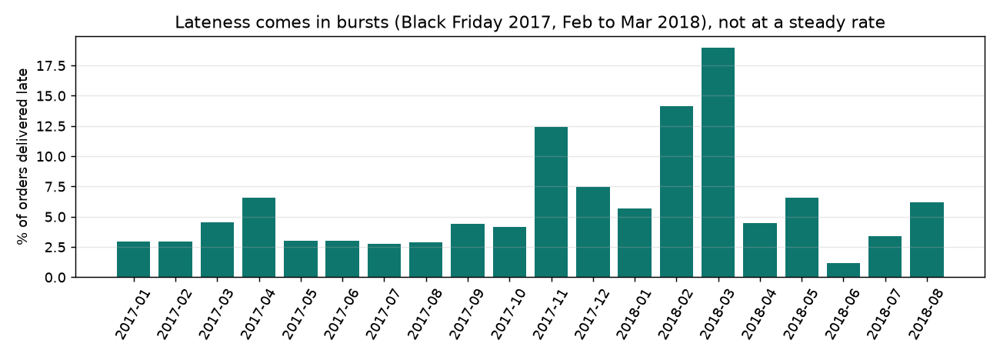
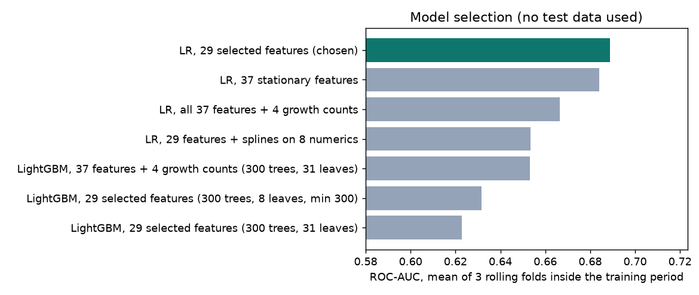
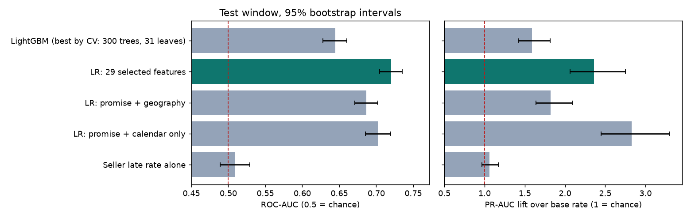
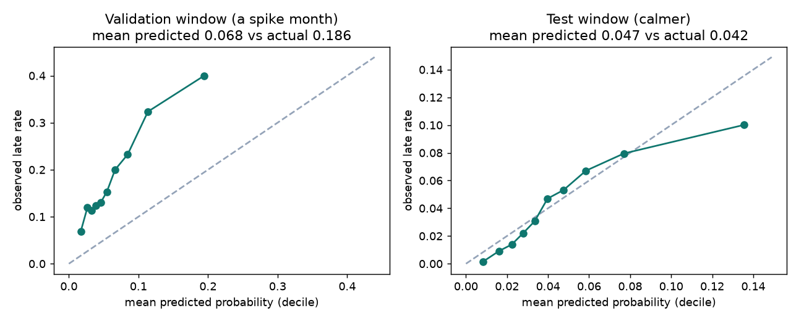
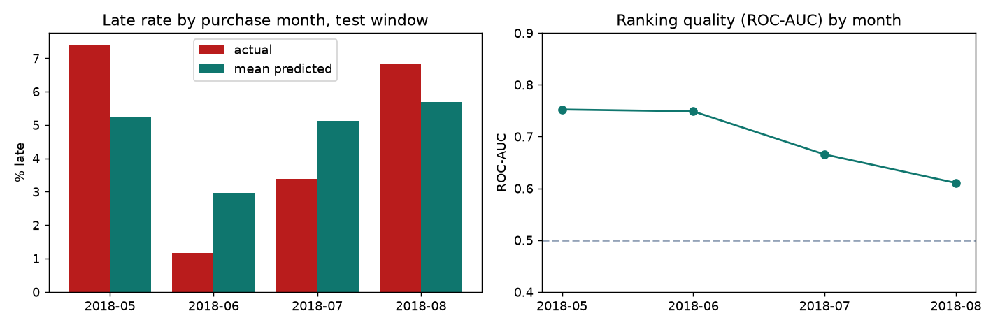
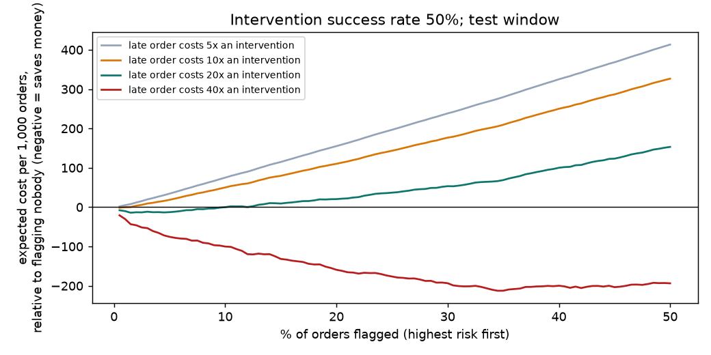

# Late-delivery risk: will this order miss its promised date?

An end-to-end classical ML project on e-commerce data: **data collection** (Olist plus two public APIs), **EDA**, **leakage-safe feature engineering**, **model selection by rolling cross-validation**, a **single honest test evaluation**, **calibration and drift analysis**, a **cost-based decision analysis**, and **deployment** (FastAPI in Docker, Streamlit app, parity tests).

The question: *at the moment an order is placed, how likely is it to arrive after the date promised to the customer?*

## Headline results

On **20,874 later orders** the model never saw (4.2% delivered late):

- **ROC-AUC 0.720 [0.705, 0.735]** and **24% of late orders caught in the riskiest 10%** of orders (a random 10% catches 10%). Clearly better than chance, and clearly **modest**.
- A regularised **logistic regression beat gradient boosting** (ROC-AUC 0.720 vs 0.645; paired difference +0.075 [+0.064, +0.087]). The choice was made by rolling cross-validation, not by looking at the test set.
- **Most of the signal is how the promise was set.** A model with 5 promise-and-calendar features scores ROC-AUC 0.703; the paired difference to the 29-feature model is +0.017 [-0.005, +0.039], i.e. not distinguishable.
- **Seller lateness is concentrated but not persistent**: the top 10% of sellers account for 74% of late orders, yet a seller's late rate barely carries over between periods (rank correlation 0.21 within the training year, 0.09 into the test period). A seller's historical late rate alone scores 0.51 (chance).
- **Rainfall**, collected from a public API, adds only about +0.002 ROC-AUC once other features are in (its raw association with lateness is strong but confounded with season and region).
- **Probabilities are regime-dependent and ranking quality decays**: ROC-AUC by month is 0.75, 0.75, 0.67, 0.61 (May to August 2018).
- **Acting on the predictions only pays when interventions are cheap relative to late orders**: at a late-order cost of 10x an intervention (50% success) flagging saves essentially nothing; at 40x it saves about 12%.



## Quick start

```bash
python -m venv .venv && source .venv/bin/activate
pip install -r requirements.txt
export PYTHONPATH=src
python -m delivery.collect            # Olist (needs Kaggle credentials), holidays, weather
python -m delivery.pipeline           # features, cross-validation, test evaluation, figures, model artifacts (about 100 s)
pytest                                # 20 tests
uvicorn app.main:app --port 8000      # API, docs at http://localhost:8000/docs
streamlit run app/streamlit_app.py    # interactive app
docker build -t delivery-risk-api . && docker run -p 8000:8000 delivery-risk-api
```

Notebooks (run cell by cell, with saved outputs): `notebooks/01_data_and_eda.ipynb`, `notebooks/02_modeling_and_evaluation.ipynb`.

## Data

- **Olist Brazilian E-Commerce Public Dataset** (Kaggle, CC BY-NC-SA 4.0): about 100,000 orders, 2016 to 2018.
- **Public holidays** (Nager.Date API) and **daily rainfall/temperature per state** (Open-Meteo archive API), collected by `delivery.collect` (no API keys).
- **Label:** late = delivered on a later *calendar day* than promised: 6.8% of delivered orders. (The promised date has no time of day, so a timestamp comparison would wrongly mark same-day deliveries as late: 8.1%.)

## Evaluation protocol

Lateness comes in bursts (3% for most of 2017, then 12% in Nov 2017, 14% in Feb 2018, 19% in Mar 2018) and late orders resolve slowly: **60% of late orders are still undelivered four weeks after purchase**. Training on the most recent orders would show only the on-time ones, so each boundary has a **45-day maturity gap**, and training orders whose outcome was not yet known on the model date are dropped.

| Window | Purchases | Orders | Late rate | Role |
|---|---|---|---|---|
| train | 2017-01-01 to 2018-01-14 | 46,461 | 5.4% | fit the model |
| validation | 2018-03-01 to 2018-03-30 | 6,802 | 18.6% | a spike month; calibration study |
| test | 2018-05-15 to 2018-08-21 | 20,874 | 4.2% | evaluated once |

The test window ends on 2018-08-21 because the dataset's daily volume collapses after that (an extraction cutoff) and those orders' late deliveries are missing. Including the tail changes nothing material (ROC-AUC 0.721 on 21,555 orders).

**No leakage by construction, and by test.** Every feature is known at purchase time. Seller, route and platform statistics use only deliveries completed *strictly before* the order's purchase time; `tests/` recompute them by brute force for random orders and check the split gaps and label rule.

## Model selection (cross-validation inside the training period only)

Three rolling folds (calm Aug to Sep 2017, Black Friday Nov to Dec 2017, February 2018 spike), each with a maturity gap.

| Candidate | CV ROC-AUC | CV PR lift | CV top-10% capture | AUC by fold |
|---|---|---|---|---|
| LR, all 37 features + 4 growth counts | 0.667 | 1.76 | 21.8% | 0.665 / 0.639 / 0.695 |
| LR, 37 stationary features | 0.684 | 1.90 | 23.4% | 0.668 / 0.684 / 0.700 |
| LR, 29 selected features (chosen) | 0.689 | 1.94 | 23.3% | 0.669 / 0.686 / 0.712 |
| LR, 29 features + splines on 8 numerics | 0.653 | 1.67 | 20.5% | 0.626 / 0.658 / 0.677 |
| LightGBM, 37 features + 4 growth counts (300 trees, 31 leaves) | 0.653 | 1.83 | 23.5% | 0.625 / 0.637 / 0.698 |
| LightGBM, 29 selected features (300 trees, 31 leaves) | 0.623 | 1.70 | 20.3% | 0.619 / 0.592 / 0.658 |
| LightGBM, 29 selected features (300 trees, 8 leaves, min 300) | 0.632 | 1.72 | 19.8% | 0.634 / 0.594 / 0.667 |



- Replacing four **growth-trending counts** (cumulative seller counts, platform volume) with scale-free ratios helped the linear model. Counts that grow with the business behave like a calendar clock that flexible models memorise.
- **Linear beat boosting in every fold**; smooth spline terms also hurt. With about 2,500 late training orders and regime-driven lateness, trees memorise episodes.
- Feature groups chosen by drop-one cross-validation (negative = the group helps):

| Dropped group | Features | Change in CV ROC-AUC |
|---|---|---|
| promise_calendar | 5 | -0.0609 |
| geography | 4 | -0.0322 |
| system_lateness | 3 | -0.0138 |
| seller_history | 6 | -0.0122 |
| order_payment | 8 | -0.0026 |
| holidays | 3 | -0.0025 |
| weather | 4 | -0.0016 |
| route_history | 1 | +0.0013 |
| product | 3 | +0.0038 |

Dropped from the final model: **weather** (+0.002, and it would need a live feed when serving), **product** and **route history** (removing them did not hurt). Final: 29 features.

**Process note.** My very first quick run touched the test set and showed linear beating boosting. I did not tune on test: I diagnosed why (feature drift and non-persistent seller effects), redesigned the features, and made all final choices with cross-validation. The test set was then evaluated once.

## Test results (single evaluation, 95% bootstrap intervals)

| Model | ROC-AUC | PR-AUC | Late orders in riskiest 10% |
|---|---|---|---|
| Base rate (no model) | 0.500 [0.500, 0.500] | 0.042 [0.042, 0.042] | 10.0% |
| Seller's historical late rate alone | 0.510 [0.489, 0.529] | 0.045 [0.041, 0.050] | 11.8% |
| LR: promise + calendar only | 0.703 [0.685, 0.720] | 0.120 [0.104, 0.140] | 31.0% |
| LR: promise + geography | 0.686 [0.671, 0.702] | 0.077 [0.069, 0.089] | 18.3% |
| LR: 29 selected features | 0.720 [0.705, 0.735] | 0.100 [0.087, 0.117] | 23.6% |
| LightGBM (best by CV: 300 trees, 31 leaves) | 0.645 [0.628, 0.660] | 0.067 [0.060, 0.077] | 16.4% |



LightGBM over 5 seeds: ROC-AUC 0.652 +/- 0.007. Dropping one group from the final model (test window):

| Dropped group | Change in test ROC-AUC |
|---|---|
| promise_calendar | -0.1421 |
| order_payment | +0.0025 |
| geography | -0.0403 |
| seller_history | -0.0097 |
| system_lateness | -0.0135 |
| holidays | -0.0093 |

## Calibration and drift

- **Raw probabilities** are well calibrated on the test period (predicted 4.7%, actual 4.2%) but far too low in spike months (predicted 6.8% for March, actual 18.6%): the model's *level* does not adapt to the regime, while its *ordering* still works.
- A **calibrator fitted on the March spike makes things worse** on test: Platt scaling predicts 14.1% against 4.2% actual; Brier 0.040 to 0.052. So the deployed model uses the **raw probability plus a rank-based flag** (riskiest 10% of recent orders).
- **Ranking quality decays** after training:

| Month | Orders | Late rate | Mean predicted | ROC-AUC |
|---|---|---|---|---|
| 2018-05 | 2,952 | 7.4% | 5.3% | 0.752 |
| 2018-06 | 6,096 | 1.2% | 3.0% | 0.749 |
| 2018-07 | 6,156 | 3.4% | 5.1% | 0.666 |
| 2018-08 | 5,670 | 6.8% | 5.7% | 0.610 |




Largest input shifts (population stability index, training to test): holiday window 2.0, platform late rate 1.4, days to next holiday 1.1 (0.25 is "large"). A retraining cadence is needed.

## Would acting on the predictions pay?

Flagging an order triggers an intervention that costs 1 unit and prevents the lateness with probability *s*; an unprevented late order costs *L*. Flagging pays only where P(late) > break-even precision = 1 / (s x L). The model's precision is 20% for its riskiest 1%, 17% for 2%, 13% for 5% and 10% for 10%.

| Late order costs | Intervention success | Break-even precision | Saving, best flag share* | Saving, theory-based threshold |
|---|---|---|---|---|
| 10x | 50% | 20.0% | +0.3% (flag 0%) | +0.2% (flag 1%) |
| 10x | 80% | 12.5% | +2.0% (flag 2%) | +0.4% (flag 4%) |
| 20x | 50% | 10.0% | +1.7% (flag 2%) | +0.5% (flag 8%) |
| 20x | 80% | 6.2% | +11.9% (flag 34%) | +10.8% (flag 22%) |
| 40x | 50% | 5.0% | +12.5% (flag 34%) | +11.8% (flag 32%) |
| 40x | 80% | 3.1% | +36.0% (flag 50%) | +36.0% (flag 59%) |

\*The best share is picked with test data, so it is slightly optimistic; the threshold needs no tuning on test.



So an ROC-AUC of 0.72 is only valuable when acting is *cheap relative to the cost of a late order*. The cost ratios are assumptions, not measurements: no intervention was ever tried. For scale, late orders in this data average 2.27 review stars against 4.29 for on-time orders.

## Deployment

- **API** (`app/main.py`, FastAPI): `POST /predict` returns the late probability, a risk percentile among recent orders, a flag, the top contributing factors (exact for a linear model), and warnings (for instance an unseen seller); `/predict/batch`, `/health`, `/model`, `/sample-orders`. Bad input gets a 422, not a crash.
- **Docker**: `Dockerfile` builds a serving-only image (no training libraries). Built and run in testing: `/health` healthy, a real order scored, a bad request rejected with 422. The image is large (about 980 MB; pandas, scikit-learn and pyarrow dominate) and could be slimmed.
- **Training/serving parity** (`tests/test_serving.py`): serving builds features from lookup tables "as of" a snapshot; the test checks that for real orders all 29 features equal the batch pipeline's features at the order's purchase time. It was verified to fail when a single constant is changed by one unit.
- **Streamlit app** (`app/streamlit_app.py`): score an order and see why, the evaluation, the cost trade-off with sliders, and drift. scikit-learn is pinned to the training version because the model is a pickled pipeline.

**Monitoring plan (designed, not built):** log every score and, once resolved, the outcome; track weekly ROC-AUC and observed late rate; alert when an input's population stability index passes 0.25 or weekly AUC falls below 0.60; retrain monthly on orders at least 45 days old.

## Limitations (also in `docs/MODEL_CARD.md`)

- Brazilian marketplace data from 2016 to 2018; nothing here is evidence about any other company or country.
- Orders never delivered are not in the data, and late deliveries of the newest orders are right-censored.
- The signal is modest, and the cost figures are assumptions. No intervention was tested, so no claim of impact is made.
- The model uses the customer's state, which may disadvantage some regions if used to decide who gets a better promise; check before acting on it.
- Seller statistics shown in the app are as of the end of the usable data (2018-08-22), so replaying an old order can differ from its score at purchase time (the batch score is shown alongside).
- A few reasonable LightGBM configurations lost; more tuning could narrow the gap, so "linear wins here" is not "linear always wins".

## Layout

```
src/delivery/   collect.py (data collection)   data.py (order table, label)   features.py + history.py (leak-free features)
                split.py + config.py (time protocol)   modeling.py (models, metrics, CIs, costs)   pipeline.py (the whole run)
                eda.py + report.py (figures)   explain.py (exact explanations)   serve.py + geo.py (serving)
app/            main.py (FastAPI)   streamlit_app.py   requirements.txt (for Streamlit Cloud)
models/         model.joblib, meta.json, lookups/ (small tables)           reports/   results.json, cv_*.csv, figures/
notebooks/      01_data_and_eda.ipynb   02_modeling_and_evaluation.ipynb  tests/     20 tests
Dockerfile      requirements.txt (dev)   requirements-serve.txt (image)
```

License: MIT (code). Data: see the sources above.
